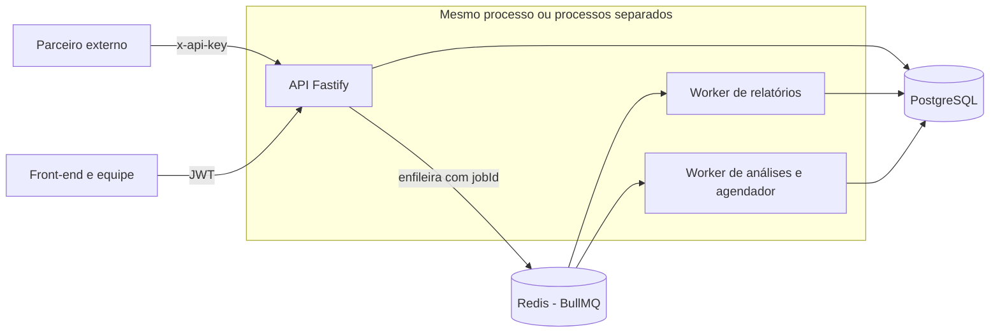
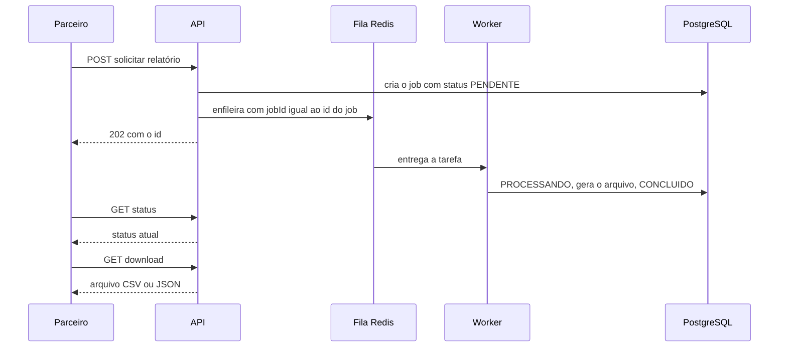

# Relatório Técnico - GreenCode AV3: Camada Analítica e API Pública

Este documento justifica as decisões arquiteturais da AV3 (camada analítica, API pública e processamento assíncrono) e registra, com transparência, as limitações que permanecem.

## 1. Visão Geral

O GreenCode continua sendo um monólito modular em camadas (Controller, Service, Repository). A AV3 acrescenta quatro peças ao mesmo código: serviços analíticos independentes, uma API pública versionada, uma fila de processamento (BullMQ + Redis) e um agendador de tarefas recorrentes.

| Superfície | Prefixo | Autenticação | Documentação |
|---|---|---|---|
| Interna | `/api/v1/internal` | JWT + RBAC | `/docs/internal` |
| Pública | `/api/v1/public` | Chave de API (`x-api-key`) + escopos | `/docs/public` |

Os workers rodam no mesmo processo da API por padrão. Com `ENABLE_WORKER=false` na API e `npm run worker` em outro terminal, eles sobem separados, sem alterar o código.

## 2. Camada Analítica

### 2.1 Escolha da biblioteca estatística

| Opção | Decisão | Motivo |
|---|---|---|
| **simple-statistics** | Escolhida | As necessidades são média, mediana, desvio padrão e regressão linear simples, exatamente o que ela oferece. É pequena, traz tipos TypeScript e expõe funções puras, fáceis de testar. |
| mathjs | Rejeitada | Recursos de matrizes, expressões e unidades muito além do necessário, com mais superfície e peso. |
| OLS implementado à mão | Rejeitada | Permitido pelo enunciado, mas reimplementaria fórmulas já validadas, aumentando o risco sem ganho. |

As chamadas à biblioteca ficam isoladas em `src/utils/estatistica.ts`, com salvaguardas próprias (mínimo de amostras, exigência de tendência negativa) e testes com resultado conhecido: dados perfeitamente lineares recuperam inclinação -0,3, intercepto 3 e vida útil de 10 anos. O desvio padrão reportado é o **populacional** (`standardDeviation`), não o amostral.

### 2.2 As três análises

Os três serviços são independentes (`src/services/analytics/`), funções puras sobre os dados lidos pelo repositório, e acessíveis por endpoint, por relatório assíncrono e pelo agendador.

**Eficiência operacional**
- *Tempo de triagem do lote:* do `dataRecebimento` até a última saída de `EM_TRIAGEM` entre seus equipamentos. Só entram lotes com a triagem concluída; os demais contam em `lotesEmAndamento`. Lotes cancelados ficam de fora.
- *Gargalo:* tempo médio de permanência em cada status, medido entre movimentações consecutivas. A etapa `RECEBIDO` vai do recebimento do lote até a primeira movimentação. O gargalo é a etapa de maior média com ao menos 3 amostras.
- *Operadores:* cada etapa é atribuída ao operador que registrou a movimentação que a encerrou. A espera inicial não é atribuída a ninguém.
- *Períodos:* agrupamento pelo mês de recebimento do lote.

**Rentabilidade por tipo de equipamento**
- Média, mediana, desvio padrão e total do `valorRecuperacao` por tipo, detalhados por condição física, marca e modelo, mais um ranking por valor médio.
- É uma estimativa **descritiva** (o que foi observado em cada grupo), não um modelo preditivo.

**Vida útil remanescente (preditiva)**
- Cada condição vira uma nota: `BOM`=3, `REGULAR`=2, `RUIM`=1, `INSERVIVEL`=0 (`NAO_AVALIADO` é ignorado). O eixo x é a idade na avaliação (ano da avaliação menos ano de fabricação).
- Mínimos quadrados ordinários por tipo: `nota = intercepto + inclinação × idade`. A vida útil estimada é a idade em que a reta chega a zero (`-intercepto / inclinação`).
- Salvaguardas: mínimo de 5 amostras, ao menos 2 idades distintas, inclinação negativa e resultado positivo. Fora disso, o resultado é nulo, com uma `observacao` explicando o motivo.
- Por equipamento: vida restante = `max(0, vida estimada - idade atual)` e ano inservível projetado. Equipamentos já descartados ficam fora.
- O modelo é treinado com os dados de **todas** as organizações, para ter amostras suficientes. O filtro por organização afeta apenas a lista por equipamento.
- *Previsão versus realização:* cada execução grava a vida útil estimada e a idade média dos equipamentos já inservíveis (`idadeInservivelObservadaAnos`). A série histórica permite medir o erro do modelo e refiná-lo.

### 2.3 Limitações do modelo

- Os dados são transversais: comparam equipamentos diferentes em idades diferentes. Não há histórico de condição do mesmo equipamento ao longo do tempo.
- A escala ordinal de condição é tratada como numérica, com espaçamento igual entre os níveis.
- O modelo é linear, e o `r2` é reportado para que o usuário avalie a qualidade do ajuste. A idade tem granularidade de ano.
- Os dados do seed são sintéticos: demonstram o mecanismo, não resultados reais.

## 3. Modelagem das Tabelas

| Tabela | Finalidade | Colunas principais | Índices |
|---|---|---|---|
| `relatorios_analiticos` | Snapshot de uma execução de análise | `categoria`, `origem` (AGENDADO ou MANUAL), `resultado` (JSON), `geradoEm` | `(categoria, geradoEm)` |
| `previsoes_vida_util` | Parâmetros do modelo por tipo e execução | `tipoEquipamento`, `amostras`, `inclinacao`, `intercepto`, `r2`, `vidaUtilEstimadaAnos`, `idadeInservivelObservadaAnos`, FK para o snapshot | `(tipoEquipamento, createdAt)` |
| `relatorio_jobs` | Estado dos relatórios assíncronos dos parceiros | `categoria`, `formato`, `status`, `tentativas`, `erro`, `resultado` (texto), FK para a chave | `(apiKeyId, createdAt)` |
| `api_keys` | Credenciais dos parceiros | `prefixo` (único), `hash`, `scopes`, `limitePorMinuto`, `ativa`, `revogadaEm`, FK para a organização | `prefixo` único |

Justificativas:

- **JSON em `relatorios_analiticos`:** o formato do resultado difere por categoria e evolui. Cada snapshot fica imutável e autossuficiente: um relatório antigo mostra exatamente o que foi calculado, mesmo que as regras mudem depois, e não exige migração a cada nova métrica. O histórico se consulta por categoria e data. A coluna `parametros` está reservada para filtros futuros (hoje fica nula, porque os snapshots agendados são globais).
- **Normalização em `previsoes_vida_util`:** os parâmetros do modelo precisam ser consultáveis como série temporal (tipo por data) para comparar previsão e realização, que é o dado que permite refinar o modelo.
- **`relatorio_jobs` como fonte de verdade:** o Redis é volátil e só coordena a execução. O status que o parceiro vê vem do banco, com uma máquina de estados explícita: `PENDENTE`, `PROCESSANDO`, `CONCLUIDO` ou `FALHA`. Entre tentativas o status volta a `PENDENTE`.
- **`api_keys`:** o `prefixo` único localiza a chave sem varrer hashes. A revogação é lógica (`ativa` e `revogadaEm`), o que preserva a auditoria. A `organizacaoId` fixa o escopo de dados da chave.
- Todas as chaves estrangeiras usam `onDelete: Restrict`, consistente com o AV2.

## 4. API Pública

| Método | Rota (`/api/v1/public`) | Escopo |
|---|---|---|
| GET | `/equipamentos/:codigoBarras/rastreabilidade` | `RASTREABILIDADE_READ` |
| GET | `/lotes` e `/lotes/:id` | `LOTES_READ` |
| POST | `/lotes` | `LOTES_WRITE` |
| POST | `/relatorios` | `RELATORIOS_READ` |
| GET | `/relatorios/:id` e `/relatorios/:id/download` | `RELATORIOS_READ` |

- **Segregação:** a API pública vive em um contexto encapsulado do Fastify, com Swagger próprio. A interna não aparece na documentação dos parceiros.
- **Versionamento:** a versão fica na URL. Mudanças que quebrem o contrato entrarão em `/v2`, convivendo com a `/v1` até a depreciação gradual.
- **Isolamento:** o `organizacaoId` vem da chave, nunca do cliente. Recursos de outra organização respondem 404, para não revelar que existem.
- **Limite de requisições:** `limitePorMinuto` por chave, com resposta 429.
- **Documentação:** cada rota traz exemplos de requisição e resposta e a lista de códigos de erro. Detalhes de segurança estão em `docs/SEGURANCA.md`.

## 5. Processamento Assíncrono e Política de Retry

| Parâmetro | Relatórios dos parceiros | Recálculo agendado |
|---|---|---|
| Tentativas | 3 (`RELATORIO_TENTATIVAS`) | 3 |
| Backoff | exponencial, base 2 s (`RELATORIO_BACKOFF_MS`): 2 s, depois 4 s | exponencial, base 5 s: 5 s, depois 10 s |
| Concorrência | 2 (`WORKER_CONCURRENCY`) | 1 |
| Retenção | concluídos por 1 h (máx. 1000); falhos por 7 dias | últimos 30 concluídos; falhos por 30 dias |

**Por que essa política.** Falhas transitórias (conexão com o banco, timeout) costumam se resolver em segundos. O backoff exponencial evita insistir em um recurso em dificuldade, e 3 tentativas limitam o custo. Esgotadas, a falha vira estado final visível (`FALHA`), em vez de repetir para sempre. O recálculo agendado usa base maior porque é uma tarefa pesada e ninguém espera por ela.

**Garantias.**
- *Idempotência:* o `jobId` do BullMQ é o id do registro no banco, então enfileirar duas vezes não duplica. Processar um job já concluído não faz nada, e registrar uma falha nunca sobrescreve um job concluído.
- *Transparência:* o parceiro vê `status`, `tentativas` e `erro`. Só mensagens de negócio chegam a ele, e erros internos viram uma mensagem genérica (o detalhe fica no log do servidor).
- *Redis indisponível:* o `POST` responde 503, o job é marcado como `FALHA` e a API continua no ar.
- *Queda do worker no meio da tarefa:* o BullMQ detecta a tarefa travada e a recoloca na fila. A idempotência torna o reprocessamento seguro.
- *Agendamento:* um job recorrente com identificador fixo (`recalculo-diario`), todo dia às 02:00 em `America/Sao_Paulo`. Reiniciar o servidor ou subir várias instâncias não duplica a execução.

## 6. Evolução para Centenas ou Milhares de Parceiros

| Ponto | Hoje | Evolução |
|---|---|---|
| Rate limit | Contador em memória do processo: com N instâncias, o limite efetivo vira N vezes o configurado | Usar o store Redis do `@fastify/rate-limit` para um limite global, com limites por plano |
| Validação da chave | Uma consulta ao banco por requisição (o último uso é gravado no máximo 1 vez por minuto) | Cache com TTL curto, invalidado na revogação |
| API | Stateless (JWT e chave de API) | Várias instâncias atrás de um balanceador |
| Workers | No mesmo processo ou dedicados (`npm run worker`) | Escalar workers independentemente da API, com filas por prioridade ou plano |
| Justiça entre parceiros | Sem limite de relatórios pendentes por chave | Limite de jobs pendentes e de concorrência por parceiro, para um não monopolizar a fila |
| Arquivos dos relatórios | Coluna de texto no PostgreSQL | Object storage compatível com S3, com URL assinada, expiração e job de limpeza |
| Cálculo analítico | Carrega os dados em memória e calcula em Node | Agregação em SQL (funções de janela), views materializadas ou agregados incrementais, réplica de leitura, snapshots por organização |
| Banco | Índices apenas nas chaves únicas | Índices em `movimentacoes(equipamentoId, dataHora)`, `equipamentos(loteId)` e `lotes(organizacaoId)`, pool de conexões (PgBouncer), particionamento de `movimentacoes` por data |
| Notificação | Polling | Webhooks assinados (HMAC) com retry próprio, além do polling |
| Retry | Repete qualquer falha | Classificar erros: transitórios repetem, permanentes falham de imediato (`UnrecoverableError`), com alerta sobre a fila de falhas |
| Chaves | Sem expiração nem rotação | Expiração, rotação com sobreposição, HMAC com segredo adicional, lista de IPs permitidos |
| Comercial | Limite por chave | Planos de acesso (limite, escopos, cota mensal) com medição de uso por chave |
| Observabilidade | Logs | Logs estruturados, métricas (fila, latência, taxa de 429), health check de banco e Redis, tracing |
| Versionamento | `/v1` | `/v2` convivendo com `/v1`, com cabeçalhos `Deprecation` e `Sunset` |

## 7. Limitações Conhecidas

- Requisições rejeitadas na autenticação (401) ou por falta de escopo (403) não chegam ao limitador por chave. Hoje não há limite por IP no contexto público. Mitigação prevista: proxy reverso ou WAF, ou limitador por IP com store Redis.
- Os relatórios ficam no banco, sem expiração automática, e o acompanhamento é só por polling (sem webhook).
- O modelo preditivo é simples (seção 2.3), e o retry repete qualquer tipo de falha.
- As chaves de demonstração do seed estão publicadas no README: servem apenas para desenvolvimento e devem ser revogadas em qualquer ambiente real.

## 8. Compatibilidade de Plataformas

**Requisitos:** Node.js 20 ou superior, npm 10 ou superior e Docker (PostgreSQL 16 e Redis 7 em containers; o Redis não tem versão oficial para Windows, por isso os dois serviços rodam em containers).

**Decisões de projeto:**
- Nenhum código depende do sistema operacional: os relatórios ficam no banco, sem manipulação de caminhos de arquivo.
- Os fins de linha são normalizados (`.gitattributes` com `eol=lf`), e os scripts npm não usam comandos específicos de shell.
- As dependências nativas (bcrypt, engines do Prisma, esbuild) distribuem binários para Windows e Linux.
- A pasta de documentação é `docs/`, em minúsculas, porque o Linux diferencia maiúsculas.

| Plataforma | Validação |
|---|---|
| Windows (versão 10.0.26300) | Desenvolvimento e suíte completa de testes |
| Ubuntu 24.04 | **[PREENCHER NO PASSO 6.3]** |